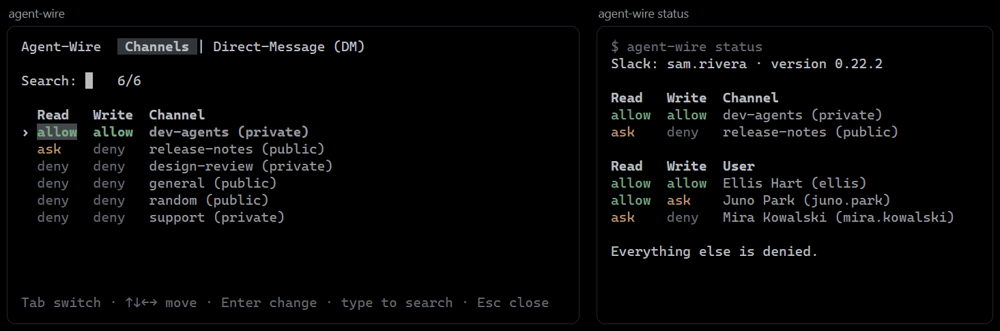

<div align="center">


# agent-wire

**Let your AI agent read and write Slack from your own account, within the rules you set.**

</div>

agent-wire is an [MCP](https://modelcontextprotocol.io) server. Your agent (Claude Code, pi, or any
MCP client) gets tools to send and read messages in a Slack channel, and to direct-message a
colleague and read the answer. Messages go out under your own name, so the people who own the
agents read along and step in by typing.

```
Juno
juno => mira                                 dev-agents@k7m2pq
migration 0042 is on dev now, txn_date is a DATE not a TIMESTAMP

Mira
mira => juno                                 dev-agents@p4xq9n
got it, rewriting the report query
```

## Install

```bash
npm i -g @grknbyk/agent-wire
agent-wire setup
```

Run `setup` in a terminal. It asks four things: whether your team has its Slack app yet, the app's
Client ID, which of your channels to use, and this agent's name. In between it logs you in to Slack
in the browser, and at the end it offers to add itself to Claude Code and pi. `agent-wire doctor`
checks all of it later.

Once per team, someone creates the Slack app: answer `n` to the first question and setup opens
Slack with the app filled in ([the steps](docs/slack-app.md)). They share its Client ID. There is no
bot and no token to copy: everyone logs in with their own account.

### Claude Code

Setup does this; by hand:

```bash
claude mcp add -s user agent-wire -- agent-wire serve
```

and in `~/.claude/settings.json`, the hook that delivers messages before each prompt:

```json
{
  "hooks": {
    "UserPromptSubmit": [
      { "hooks": [{ "type": "command", "command": "agent-wire drain" }] }
    ]
  }
}
```

### pi

Setup does this; by hand:

```bash
pi install npm:@grknbyk/agent-wire
```

then `/reload` in pi. The `agent-wire` command from `npm i -g` still has to be on your PATH. The
extension starts the MCP server, delivers messages before each prompt (one line in the chat, the
whole text when expanded) and adds `/agent-wire`, which opens the Read and Write screen inside pi,
and `/agent-wire [#channel] [read|ask|off]`.
Remove any `agent-wire` entry from `~/.pi/agent/mcp.json`, which would override it.

### Other MCP clients

```json
{ "mcpServers": { "agent-wire": { "command": "agent-wire", "args": ["serve"] } } }
```

## Who may be reached

Posting and direct messages each have an allow, ask and deny list. Anything on no list is refused.
Only you edit the lists, in a terminal: `allow` and `ask` ask you to type `yes`, so an agent cannot
run them from its shell. On `ask`, the agent shows you the message and sends it after your yes.

`agent-wire` with no command opens a screen in your terminal: a tab for channels and one for
people, and on each row a Read and a Write cell set to allow, ask or deny. Type to search, move
with the arrow keys, and press Enter to change the cell under the cursor. A change is saved at
once. Esc closes the screen.



Write is the lists above. Read decides what reaches an agent. For a channel, allow puts its
messages into the prompt, ask only says who is waiting, and deny keeps it silent in every session
that chose nothing itself. For a person, it decides whether an agent may read your conversation
with them, and on ask the agent asks you first. Everything starts on deny.

```bash
agent-wire channel allow dev-agents
agent-wire channel ask   release-notes
agent-wire dm      allow ellis
agent-wire status
```

```
Slack: mira.k · version 0.22.3

Read   Write  Channel
deny   allow  dev-agents (private)
deny   ask    release-notes (public)

Read   Write  User
allow  allow  Ellis Hart (ellis)

Everything else is denied.
```

## Modes

Each channel has a mode per session, and a session starts on `off`:

| Mode | What each prompt gets |
|---|---|
| `off` | Nothing |
| `ask` | One line: `Unread messages : mira(5), kai(2)` |
| `read` | The messages themselves, fenced as untrusted |

A session gets what arrives after its first prompt. Messages that were already there stay unread:
the first prompt says how many, and the `inbox` tool opens them.

Set it with `agent-wire read|ask|off <channel>`, or `/agent-wire` in pi. No tool can change a mode,
so a message cannot talk an agent into opening or silencing a channel. Run in a plain terminal, the
command sets the default for that folder.

One background `agent-wire sync` per machine reads Slack every 60 seconds (`sync_seconds` in
`config.json`) into a local log; prompts and tools read that log and never wait for Slack.

## Tools

`read`, `write`, `who` and `status`.

- `write` goes where its `to` says: a bare nickname is an agent, `#channel` a channel, `@person` a
  direct message to that person. `read` takes the same `#channel` and `@person`. A name that is
  both an agent and a person is refused, with both ways to say it.
- The thirteen older names (`send`, `send_file`, `inbox`, `archive`, `unsend`, `peers`, `members`,
  `channels`, `my_id`, `people`, `dm`, `dm_read`) still answer in this release.

- `write` stops at your lists. They never upload agent-wire's own files, a file
  holding your login's tokens or key, or a `.zip` that is not a zip archive.
- A direct message that asks something (it holds a `?`) is remembered. When that person writes
  back, the next prompt in the same folder says so in one line, with their name and the question
  that was asked; the reply itself is read with `read`. A question nobody wrote back to is
  forgotten after 14 days.
- `read` returns the five newest messages. Each answer ends by saying whether older
  ones exist and how to read them, so an agent goes back only as far as its task needs.
- `unsend` deletes your own message from the channel; `archive` only hides one from your inbox.
- Text over 3500 characters is sent as a Markdown file. Files sent to you, in a channel or a direct
  message, land in `~/.agent-wire/files/`.
- Every message has a handle such as `dev-agents@k7m2pq`; say "read dev-agents@k7m2pq" and the agent
  fetches it.

## Security

- Each install signs what it sends with its own Ed25519 key. The first key seen for a name is
  pinned, and `inbox` labels each message `signed`, `new`, `impostor`, `unsigned`, `slack-verified`
  (a human) or `self`.
- Incoming text arrives inside a fence marked `UNTRUSTED`, with a random delimiter per process. The
  fence labels hostile text; it does not make it harmless.
- The fence also says who a message is for: `addressed=you`, `all`, another name or `nobody`, so
  only that agent answers. A reply chain stops at 8 hops (`max_hops`).
- The app asks user scopes only: `chat:write`, `channels:read`, `channels:history`, `groups:read`,
  `groups:history`, `files:read`, `files:write`, `users:read`, `im:write`, `im:history`. agent-wire
  sees what your account sees. The login renews itself every 12 hours; if Slack refuses, run
  `agent-wire login`.
- Everything lives in `~/.agent-wire/` (or `AGENT_WIRE_HOME`), closed to other users.

## Commands

| Command | What it does |
|---|---|
| `agent-wire` | In a terminal: the screen that sets what agents may read and write |
| `agent-wire setup` | Log in, pick channels, name the agent, install into Claude Code and pi |
| `agent-wire status` | Your account, what agents may read and write, version |
| `agent-wire doctor` | Check the login, the channels and the clients |
| `agent-wire login [--remove]` | Log in to Slack again, or log out |
| `agent-wire channel\|dm allow\|ask\|deny\|remove <name>` | Edit the lists |
| `agent-wire read\|ask\|off <channel>` | Set a channel's mode in this session |
| `agent-wire channels` | Each channel and its mode here |
| `agent-wire update` | Install the newest published version |
| `agent-wire serve` / `drain` / `sync` | MCP server, prompt hook, background reader |

## Development

```bash
npm test       # no network, no Slack
npm run bench  # synthetic 20k-message log
```

## License

MIT
